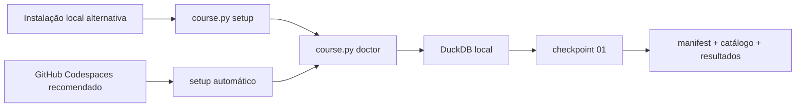
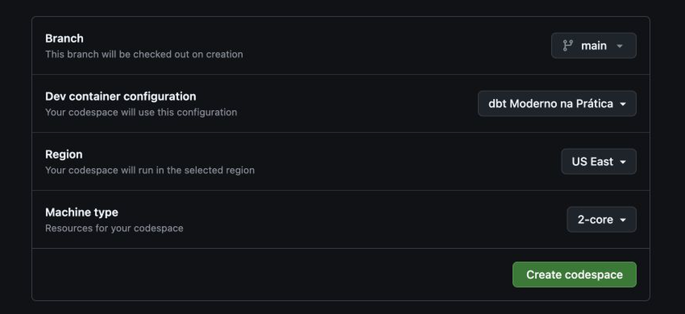

# Aula 0 — Prepare seu laboratório dbt sem sofrer com o ambiente

Com **Anselmo Borges**, que trabalha com engenharia de dados e publica workshops práticos de dbt Core no canal Rescue Point. [Perfil profissional](https://br.linkedin.com/in/anselmoborges) · [Rescue Point](https://rescuepoint.com.br/)

## Resultado da aula

Ao final, você terá criado o laboratório padronizado no GitHub Codespaces, validado o ambiente e executado o primeiro checkpoint sem conta cloud. A instalação local permanece como alternativa.

A temporada começa com uma pergunta: **quanto dos pagamentos corresponde a pedidos entregues?** Conheça os CSVs de pedidos, itens, pagamentos, clientes e municípios e veja o que cada linha representa. [Dicionário de dados e primeira consulta](praticas-duckdb.md#de-onde-vêm-os-dados)

## Rota recomendada: Codespaces

**[Abra o laboratório configurado em uma máquina de 2 núcleos](https://github.com/codespaces/new?hide_repo_select=true&ref=main&repo=1354054687)** e siga o [tutorial ilustrado de Codespaces](codespaces.md).

Essa rota é recomendada porque todos recebem Python 3.12, a mesma configuração do VS Code e as mesmas dependências. Veja os [limites da conta gratuita e como interromper o consumo](codespaces.md#franquia-gratuita-e-escolha-da-máquina).

## Passo a passo

1. Crie o ambiente pela [rota recomendada no Codespaces](codespaces.md). Se preferir trabalhar offline, use a [instalação local](instalacao/README.md).
2. No Codespaces, aguarde **Ambiente pronto** no terminal de configuração. O editor pode aparecer antes de o `setup` terminar. Na instalação local, execute `python course.py setup`.
3. Execute `python course.py doctor`. Se aparecer **Ambiente preparado**, não execute `setup` novamente; corrija apenas itens marcados como `ERRO`.
4. Execute `python course.py paths` para conferir os caminhos detectados do dbt, DuckDB, profile, banco e artifacts.
5. Execute `python course.py checkpoint 01`.
6. Procure a mensagem `Checkpoint 01 OK`.
7. Execute `python course.py data-ui`. No Codespaces, abra a porta privada 4213. Em instalação local, abra `http://localhost:4213`. Selecione **00 · Primeiras linhas dos pedidos** e clique em **Executar consulta**. Pelo terminal, use `python course.py sql 00`.
8. Se quiser usar a DuckDB UI oficial, siga a [rota opcional por túnel](codespaces.md#alternativa-avançada--duckdb-ui-oficial-por-túnel).
9. Ao terminar no Codespaces, pare o ambiente para interromper o consumo de processamento.
10. Se falhar, execute `python course.py support-report` e use o [modelo de ajuda](pedir-ajuda.md).

## O que o setup faz

Compare sua saída com a [captura real do diagnóstico e do primeiro checkpoint](resultados-dos-checkpoints.md#aula-0-e-episódio-1--ambiente-e-primeiro-build).

- Cria um ambiente Python isolado dentro do laboratório.
- Instala versões fixadas de dbt Core, DuckDB, MetricFlow e dbt MCP.
- Baixa packages dbt.
- Testa a conexão com o arquivo DuckDB local.
- Registra os caminhos efetivos em `build/environment-info.json`; ao reabrir o Codespace, o `postStartCommand` restaura o ambiente e atualiza esse arquivo.
- Não acessa Databricks e não solicita chaves.

No Codespaces, essas ações são iniciadas automaticamente pelo `postCreateCommand` versionado no repositório.

> `^C` e `KeyboardInterrupt` significam que o processo foi interrompido pelo usuário. Na primeira preparação, aguarde as três etapas terminarem. Reexecutar `setup` depois disso apenas confirma o ambiente e pula instalações já concluídas.

> O dbt Power User não é necessário. Se o editor abrir o assistente dessa extensão, feche-o e siga apenas os comandos `course.py`. O [guia de Codespaces](codespaces.md) explica por que o dbt 1.11 mostrado pelo assistente não é o dbt 1.12.7 do laboratório.

> A prática usa o Explorador DuckDB do curso, com uma cópia somente leitura do banco. A UI oficial também pode ser usada pelo túnel descrito no [guia do Codespaces](codespaces.md).

## Material complementar

- [Quickstart manual do dbt](https://docs.getdbt.com/guides/manual-install?step=1) — dbt Labs, guia/EN, comparação com a instalação oficial; verificado em 2026-09-01.
- [Jaffle Shop com DuckDB](https://github.com/dbt-labs/jaffle_shop_duckdb) — dbt Labs, repositório/EN, outro laboratório local oficial; verificado em 2026-09-01.
- [GitHub Codespaces: criar um ambiente](https://docs.github.com/en/codespaces/developing-in-a-codespace/creating-a-codespace-for-a-repository) — GitHub, documentação/EN, base oficial do caminho recomendado; verificado em 2026-09-01.
- [Limitação da DuckDB UI em containers](https://github.com/duckdb/duckdb-ui/issues/22) — DuckDB, issue oficial/EN, motivo para o explorador autoral; verificado em 2026-09-02.
- [Segurança das portas no Codespaces](https://docs.github.com/en/codespaces/reference/security-in-github-codespaces) — GitHub, documentação/EN, portas encaminhadas privadas por padrão; verificado em 2026-09-02.
