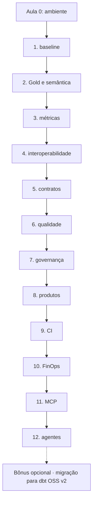

# Mapa do curso e checkpoints



Execute `setup` e o checkpoint 01 em um ambiente novo. Ele cria o banco e os artefatos que as outras aulas usam. A partir daí, cada checkpoint focaliza um tema sobre a versão cumulativa do projeto. Você pode repetir as aulas 02–12 na ordem que precisar.

```bash
python course.py checkpoint 01
python course.py checkpoint 02
# ...
python course.py checkpoint 12
```

O [índice de checkpoints](../lab/dabdbt/checkpoints/README.md) liga cada número ao seu critério de sucesso. Os [roteiros e apresentações](../roteiros/README.md) orientam a demonstração.

Após a temporada open, a [aula bônus de migração para dbt OSS v2](../roteiros/bonus-migracao-v2.md) oferece uma comparação isolada com o Core 1.12.7.

Os episódios 13–16 são uma segunda temporada proprietária. Eles não fazem parte da validação local e não serão apresentados como executados sem acesso legítimo.

## Material complementar

- [dbt Learn](https://www.getdbt.com/dbt-learn) — dbt Labs, cursos/EN, trilhas oficiais complementares; verificado em 2026-09-01.

