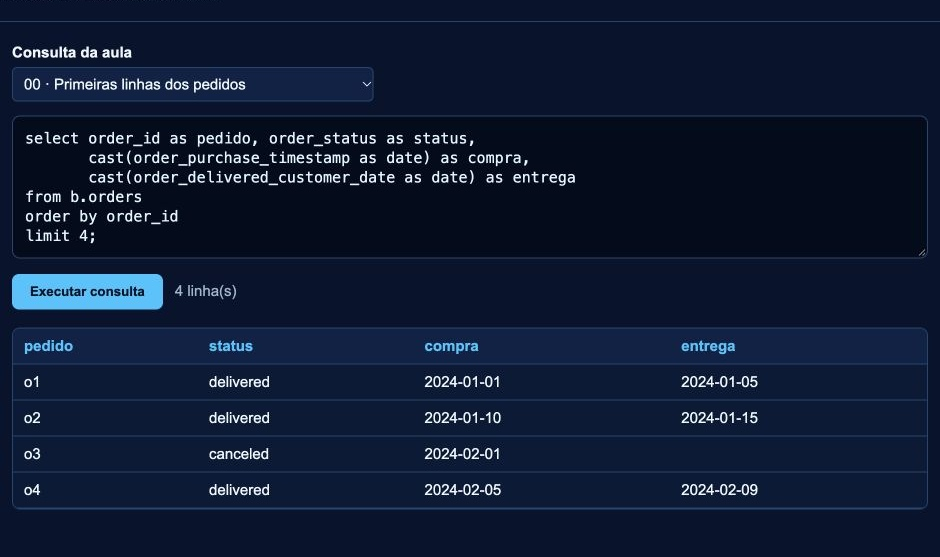
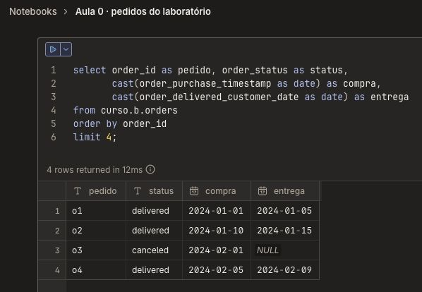
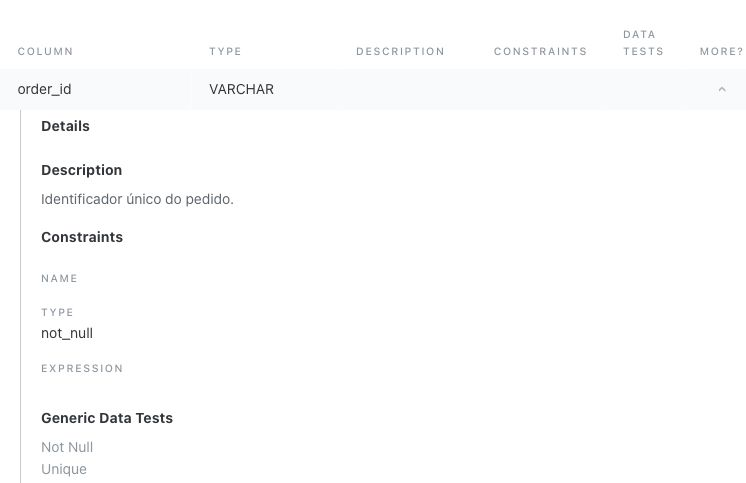
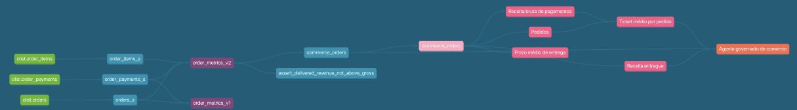
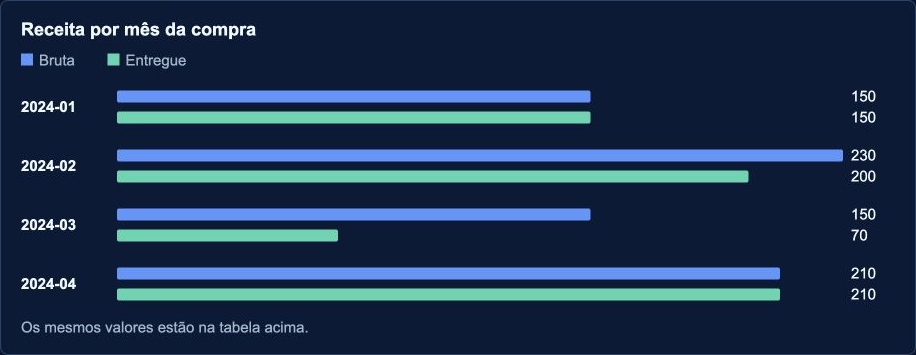

# Do arquivo CSV ao gráfico no DuckDB

A pergunta do curso é **quanto dos pagamentos corresponde a pedidos entregues?** Para respondê-la, precisamos distinguir uma linha de pedido de uma linha de item ou de pagamento. A mesma definição de receita pode então chegar ao gráfico, ao dashboard e ao agente.

## De onde vêm os dados

Os [CSVs do laboratório](../lab/dabdbt/src/seeds/) são carregados pelo `dbt seed` no schema `b` do DuckDB. Os quatro arquivos comerciais são exemplos didáticos com estrutura inspirada no conjunto público da Olist. Os pedidos do curso usam identificadores como `o1` e datas de 2024. A referência de municípios é mantida em um CSV separado para os exemplos geográficos. [Publicação original da Olist](https://www.kaggle.com/datasets/olistbr/brazilian-ecommerce)

| CSV | Relação no DuckDB | O que uma linha representa | Colunas para começar |
|---|---|---|---|
| `orders.csv` | `b.orders` | Um pedido | `order_id` e `order_status` em texto. Compra e entrega em timestamps. |
| `order_items.csv` | `b.order_items` | Um item de um pedido | `order_id` em texto, `order_item_id` inteiro, além de preço e frete numéricos. |
| `order_payments.csv` | `b.order_payments` | Uma ocorrência de pagamento | `order_id`, `payment_sequential`, meio, parcelas e valor. |
| `customers.csv` | `b.customers` | Um cadastro na amostra | `customer_id`, `customer_unique_id`, prefixo de CEP, cidade e UF. |
| `ibge_municipios.csv` | `b.ibge_municipios` | Um município | `codigo_ibge`, nome, UF, latitude e longitude. |

No Explorador, rode `describe b.orders;` para consultar os tipos inferidos para o arquivo já carregado. Depois use a consulta da Aula 0 para ver o pedido cancelado `o3`, cuja data de entrega está vazia.



## Como repetir uma consulta

1. Na raiz do curso, execute o checkpoint indicado na aula. Para a Aula 0, use `python course.py checkpoint 01`. Aguarde a confirmação de sucesso.
2. Execute `python course.py data-ui` e deixe o terminal aberto. No Codespaces, use **Portas → 4213 → Abrir no navegador** com a visibilidade **Privada**. No computador local, abra `http://localhost:4213`.
3. No menu **Consulta da aula**, escolha o número ou copie o SQL do slide para o editor. Clique em **Executar consulta**. Se você atualizar o banco depois de abrir o Explorador, encerre-o com **Ctrl+C** e inicie de novo para renovar a cópia.
4. Para obter a mesma resposta pelo terminal, use o comando da aula. Exemplo do Episódio 2:

   ```bash
   python course.py sql 02
   ```

Se o executável oficial já estiver no seu PATH, você também pode ler o arquivo diretamente, na raiz do curso:

```bash
duckdb -readonly lab/data/dabdbt.duckdb -f lab/praticas/02.sql
```

Na [DuckDB UI oficial por túnel](codespaces.md), execute o mesmo SQL em uma célula do notebook. Com o banco do curso aberto pela rotina `python course.py official-data-ui`, use as relações `b.orders`, `g.order_fulfillment` ou `semantic.commerce_orders` conforme a aula. Feche essa sessão antes de iniciar outro build, para liberar o banco.



*Na captura local, a cópia do banco foi anexada como `curso`. Por isso a referência aparece como `curso.b.orders`.*

## Por que fazemos cada transformação

| Aula | SQL copiável | O que a prática torna visível |
|---|---|---|
| 00 | [Primeiros pedidos](../lab/praticas/00.sql) | Um pedido cancelado pode ter data de entrega vazia. Status e datas dão significado a uma linha. |
| 01 | [Dependência no manifest](../lab/praticas/01.sql) | O arquivo identifica a versão que alimenta a interface. Assim você sabe onde investigar mudanças. |
| 02 | [Gold e itens](../lab/praticas/02.sql) | O join ingênuo eleva o total pago de 740 para 910 nesta amostra. A Gold consolida os pagamentos por pedido. |
| 03 | [Conferência de métricas](../lab/praticas/03.sql) | Compare o SQL com a saída do MetricFlow. Em fevereiro, 2 pedidos deram 230 de receita bruta e ticket de 115. |
| 04 | [Métricas no arquivo OSI](../lab/praticas/04.sql) | O JSON torna visíveis cinco definições para consumo por outras ferramentas. |
| 05 | [Catálogo das versões](../lab/praticas/05.sql) | A v2 acrescenta duas colunas e preserva a v1 para consumidores existentes. O checkpoint exercita uma quebra de contrato. |
| 06 | [Conferência de qualidade](../lab/praticas/06.sql) | Há 8 pedidos distintos, zero chaves nulas e zero receita entregue para pedidos com outro status. |
| 07 | [Metadados de governança](../lab/praticas/07.sql) | O manifest registra o domínio, o acesso no dbt e o exposure de consumo. |
| 08 | [Consumo da interface](../lab/praticas/08.sql) | O consumidor usa `semantic.commerce_orders` para encontrar 6 entregues e 630 de receita reconhecida. |
| 09 | [Relatório de state e defer](../lab/praticas/09.sql) | Leia quais modelos entram na seleção e qual relação foi reaproveitada. O arquivo é gerado pelo checkpoint 09. |
| 10 | [Relatório incremental](../lab/praticas/10.sql) | A comparação local tem 8 linhas candidatas na carga completa e 1 na incremental, com o mesmo resultado. |
| 11 | [Relatório do MCP](../lab/praticas/11.sql) | O SQL lê o resultado do teste que listou as ferramentas e confirmou que `build` foi rejeitado. |
| 12 | [Avaliação das fixtures](../lab/praticas/12.sql) | Compare as três rodadas gravadas. `fixtures = true` identifica o cenário de teste. |
| 12 | [SQL do gráfico final](../lab/praticas/12-insight.sql) | O gráfico compara o valor pago e a parte reconhecida como receita entregue por mês da compra. |

As consultas aos JSONs usam os caminhos relativos à raiz do repositório. Se um arquivo estiver ausente, rode o checkpoint da aula correspondente. O [guia dos checkpoints](resultados-dos-checkpoints.md) mostra também os sinais esperados no terminal.

## Documentação e linhagem geradas pelo dbt

```bash
python course.py checkpoint 01
python course.py docs
```

No Codespaces, abra a porta privada **8080** na guia **Portas**. Se ela não aparecer, adicione a porta nessa guia. No computador local, abra `http://localhost:8080`. Mantenha o terminal aberto enquanto navega.

O checkpoint executa `dbt docs generate`. Em `lab/dabdbt/target/`, `index.html` abre a interface, `manifest.json` descreve os recursos e as dependências do projeto, e `catalog.json` registra relações e colunas consultadas no banco. Descrições, testes e metadados declarados no projeto aparecem na ficha. A execução dos testes é acompanhada pelo resumo do checkpoint e pelos artifacts da execução correspondente. [Comandos de documentação do dbt](https://docs.getdbt.com/reference/commands/cmd-docs)

1. Na árvore de modelos, abra `order_metrics_v2`. Em **Columns**, expanda `order_id` para ler descrição, tipo, constraint e testes. Use **Code** para ver o SQL do modelo e o compilado quando disponível.
2. Clique em **View Lineage Graph**, amplie o painel, escreva `+order_metrics+` no campo **--select** e clique em **Update Graph**. Siga as fontes de pedidos, itens e pagamentos até os modelos Silver, as versões de pedidos, a interface `commerce_orders`, as métricas e o exposure do agente.
3. Em **Depends On**, confira quem alimenta o modelo. Em **Referenced By**, veja quem depende dele. Combine esse mapa com o SQL para entender o grão e as junções.

Nesse grafo, `order_metrics_v2` lê os três modelos Silver. Já `g.order_fulfillment` é a análise operacional de pedidos usada no Episódio 2. O gráfico final consome `semantic.commerce_orders`, a interface sobre a versão de pedidos.





### Catálogo da aula bônus

A aula bônus gera outro catálogo. Com a comparação pronta, use `python course.py bonus-v2 docs` e abra a porta privada **8580** no Codespaces ou `http://localhost:8580` localmente. Em **Assets → Models → order_fulfillment_g**, confira a descrição, as colunas e as dependências. O v2 usa um índice em Parquet dentro de `v2/target/info_schema/v1/`, além de artefatos JSON de compatibilidade. [Roteiro do bônus](../roteiros/bonus-migracao-v2.md#checkpoint-executável)

## O insight que chega ao consumidor

No Explorador, escolha **12-insight · Receita bruta e entregue por mês** e clique em **Executar consulta**. Role até o gráfico. No terminal, use `python course.py sql 12-insight` para obter a tabela que o alimenta.



Na amostra, **630 de 740** correspondem a pedidos entregues. Março concentra **80 dos 110** de diferença entre as duas medidas. A data de compra determina o mês, e o status `delivered` determina a receita entregue. O dashboard pode repetir essa consulta por mês. Um agente autorizado pode responder usando a métrica publicada e apresentar a mesma regra de negócio.

O gráfico vem dos dados do laboratório. O [checkpoint 12](../lab/dabdbt/checkpoints/12-agentes.md) testa o avaliador de agentes separadamente, usando traces gravados.

## Material complementar

- [Documentação do dbt Core](https://docs.getdbt.com/docs/build/documentation) — dbt Labs, documentação/EN, descrições e linhagem do projeto.
- [Leitura de JSON no DuckDB 1.5](https://duckdb.org/docs/1.5/data/json/loading_json) — DuckDB, documentação/EN, referência das consultas aos artifacts.
- [DuckDB UI 1.5](https://duckdb.org/docs/1.5/core_extensions/ui) — DuckDB, documentação/EN, execução local e configuração da interface.
- [Apresentações](../assets/decks/README.md) — SQL selecionável, capturas e notas por aula.
