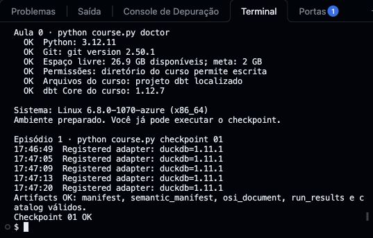
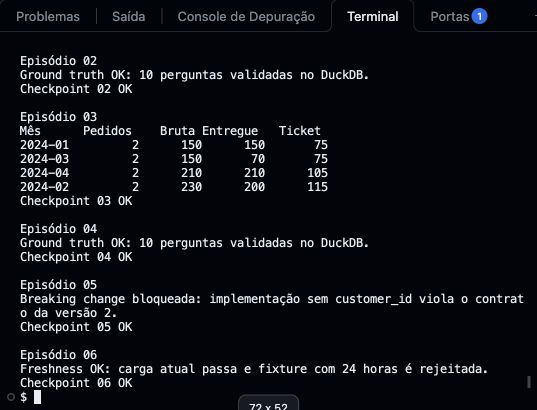
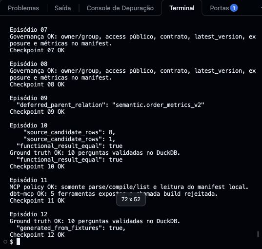

# O que observar nos checkpoints do curso

Use este guia ao lado dos slides e do terminal. Abra o [laboratório no Codespaces](codespaces.md) e aguarde a configuração automática. O slide **Comandos da prática** de cada aula traz o comando que você pode copiar para o terminal na raiz do repositório.

Os recortes abaixo mostram saídas de uma execução de 24 de novembro de 2026 no GitHub Codespaces, em Linux com Python 3.12 e dbt Core 1.12.7. Cada checkpoint bem-sucedido termina com `Checkpoint NN OK`. Os exercícios de contrato, freshness e MCP incluem rejeições esperadas.

## Aula 0 e episódio 1 — ambiente e primeiro build

*O diagnóstico confirma o ambiente. O primeiro checkpoint valida os arquivos gerados pelo dbt.*

| Aula | O que procurar |
|---|---|
| [Aula 0 · Ambiente](aula-00.md) | `doctor` termina com `Ambiente preparado`. Em `paths`, confira `duckdb.executable` e o diretório do perfil do curso. |
| [01 · Baseline e artifacts](../lab/dabdbt/checkpoints/01-core-1-12.md) | Procure `Artifacts OK` e `Checkpoint 01 OK`. Abra `lab/dabdbt/target/manifest.json` no editor e procure `parent_map` para ver as dependências entre os recursos. |

## Episódios 2 a 6 — Gold, métricas e qualidade

*Extrato da saída dos episódios 2 a 6. Na tabela do episódio 3, os nomes das colunas foram abreviados e os meses aparecem na ordem devolvida pela consulta.*

| Episódio | O que procurar |
|---|---|
| [02 · Gold e semântica](../lab/dabdbt/checkpoints/02-gold-semantica.md) | `Ground truth OK` confirma que as respostas conferem com o resultado esperado no DuckDB. |
| [03 · MetricFlow local](../lab/dabdbt/checkpoints/03-metricflow.md) | A consulta retorna uma tabela por mês com `orders`, `gross_revenue`, `delivered_revenue` e `average_order_value`. |
| [04 · Semântica interoperável](../lab/dabdbt/checkpoints/04-interfaces.md) | `Artifacts OK` inclui a validação de `osi_document.json`. `Ground truth OK` confirma as respostas pela interface SQL do laboratório. |
| [05 · Contratos e versões](../lab/dabdbt/checkpoints/05-contratos-versoes.md) | `Breaking change bloqueada` confirma que o contrato da versão 2 detectou a remoção de `customer_id` na cópia temporária. |
| [06 · Pirâmide de qualidade](../lab/dabdbt/checkpoints/06-qualidade.md) | `Freshness OK` confirma que a carga atual passou e a carga de teste com 24 horas foi rejeitada. |

## Episódios 7 a 12 — governança, CI e agentes

*Extrato da saída dos episódios 7 a 12. As contagens são da amostra do laboratório. O benchmark final usa traces gravados.*

| Episódio | O que procurar |
|---|---|
| [07 · Governança como código](../lab/dabdbt/checkpoints/07-governanca.md) | `Governança OK` confirma que o manifest registra responsável, grupo, acesso, contrato, versões, exposure e métricas. |
| [08 · Data products abertos](../lab/dabdbt/checkpoints/08-data-products-open.md) | `Governança OK` valida a interface pública de consumo dentro do projeto dbt do curso. |
| [09 · CI por estado](../lab/dabdbt/checkpoints/09-state-ci.md) | No JSON, `selected_nodes` lista `orders_s` e os dependentes selecionados. `deferred_parent_relation` mostra qual relação existente foi reaproveitada. |
| [10 · FinOps do pipeline](../lab/dabdbt/checkpoints/10-finops.md) | Compare `source_candidate_rows` e procure `functional_result_equal: true`. As durações variam com o ambiente. |
| [11 · MCP somente leitura](../lab/dabdbt/checkpoints/11-mcp.md) | `dbt-mcp OK` confirma que o servidor local expôs cinco ferramentas e rejeitou a chamada a `build`. |
| [12 · Agente governado](../lab/dabdbt/checkpoints/12-agentes.md) | `Ground truth OK` valida as 10 perguntas no DuckDB. `generated_from_fixtures: true` confirma que a comparação usa traces gravados e roda sem chamada a um modelo de IA. |

Se um checkpoint não terminar com `OK`, consulte a [solução de problemas](solucao-de-problemas.md). Para compartilhar um diagnóstico sanitizado, use `python course.py support-report` e siga o [modelo para pedir ajuda](pedir-ajuda.md).

## Material complementar

- [Configuração do Codespaces](codespaces.md) — passos de instalação, exploração do DuckDB e encerramento.
- [Apresentações do curso](../assets/decks/README.md) — roteiro, comandos copiáveis e notas do apresentador.
- [Referência do manifest](https://docs.getdbt.com/reference/artifacts/manifest-json) — dbt Labs, documentação em inglês sobre os metadados que o dbt registra.
