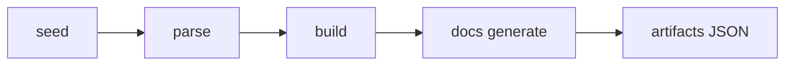

# Episódio 1 — O que a série ensinou e o baseline Core 1.12

**Duração alvo:** 20–23 minutos
**Nível:** iniciante/intermediário
**Rótulos na tela:** `OPEN`, `Core 1.12.7: laboratório`, `Radar: dbt v2 GA`

## Gancho

“Os títulos da série antiga dizem incremental, tests, docs, lineage e deploy. Mas o que nós realmente colocamos para rodar? Hoje eu vou auditar meu próprio conteúdo, corrigir o que envelheceu e deixar uma base Core 1.12 que qualquer pessoa consegue reproduzir sem cloud.”

## Objetivo e pré-requisitos

Ao final, a pessoa saberá o que pode assumir como pré-requisito, instalará a versão suportada e produzirá os quatro artifacts usados no restante da temporada.

Pré-requisitos: Python 3.12 ou 3.13, Git, terminal e `lab/dabdbt`. O conjunto fixado não suporta Python 3.14. Nenhuma conta dbt ou Databricks.



*Diagrama conceitual autoral: o ciclo executável usado como baseline da temporada.*

## Roteiro falado

### 00:00–03:30 — Auditar o conteúdo, não o título

“A aula teórica realmente explica models, `ref`, tests, docs, snapshots, perfis e materializações. Ela também defende, perto de 24 minutos, que a regra saia do BI e vá para o pipeline; perto de 45 minutos conecta qualidade de dados com a qualidade de uma LLM. Essa tese continua atual.

Nos hands-ons, o alcance é menor. Nós configuramos Python, adapter, profile, seeds e DuckDB; criamos staging, usamos `ref`, comparamos table/view e terminamos com uma Gold simples. O vídeo chamado incremental não implementa incremental. O de tests/docs executa seeds. O de deploy não faz deploy. Isso não invalida a série; apenas define onde esta nova temporada começa.”

**Visual:** tabela `título / conteúdo demonstrado / novo episódio`, baseada em `pesquisa/auditoria-playlist.md`.

### 03:30–07:00 — Cinco correções que merecem ficar registradas

“O adapter precisa ser compatível com a versão do Core. CTE ajuda a organizar o SQL e o ganho de desempenho depende do banco. Snapshot guarda histórico de mudanças. Testes reduzem risco ao verificar condições específicas. A instalação local e os planos da dbt Platform têm requisitos e licenças próprios.

O laboratório usa dbt Core 1.12.7, o adaptador `dbt-duckdb` 1.11.1 e o motor DuckDB 1.5.5. Para atualizar um ambiente preparado na Aula 0, rode `python course.py setup` uma vez após atualizar o repositório.”

### 07:00–10:30 — O projeto privado muda o diagnóstico

“Eu consegui auditar, em modo leitura, o projeto que antes parecia indisponível. Ele já tem múltiplos projetos dbt, Bundles, CI/CD, catálogo, groups, access, contratos, unit tests e exposures para aplicações. Portanto, a pergunta não é ‘como adicionar tudo do zero?’.

As lacunas reais são consistência: métricas ainda não estão como código, versões e freshness aparecem mais como orientação que execução, CI roda blocos amplos e alguns incrementais usam `merge` sem filtro incremental localizado. O laboratório transforma esses padrões em Olist, sem publicar nomes, código ou infraestrutura privada.”

**Visual:** duas colunas: `já existe` e `próxima evolução`; selo `auditoria privada anonimizada`.

### 10:30–17:30 — Demonstração estável

```bash
python course.py checkpoint 01
```

“O checkpoint carrega os seeds, cria uma fonte de freshness com horário atual, faz parse e build. Ele termina verificando quatro contratos de máquina:

- `manifest.json`: DAG, configurações, owners e exposures;
- `semantic_manifest.json`: representação usada pelo motor semântico;
- `osi_document.json`: documento semântico interoperável;
- `run_results.json`: resultado do último comando que escreveu esse arquivo. Depois do checkpoint, `args.which` indica `generate`, pois `dbt docs generate` vem depois do build.

O esperado é `Checkpoint 01 OK`. No build completo são 14 modelos, 25 data tests, cinco seeds, um unit test, cinco métricas, um semantic model, uma exposure e um group. O exposure aparece como `NO-OP`, não como erro.”

### 17:30–20:00 — Por que artifacts importam

“O HTML de documentação é útil para pessoas; artifacts são úteis para automação. A CI compara manifests. O MCP lê manifest. O benchmark descobre o contrato. O episódio nove calcula impacto. Uma única saída do Core alimenta governança, FinOps e IA sem dar ao agente acesso irrestrito ao warehouse.”

Abra `lab/dabdbt/target/manifest.json` no explorador do editor. No Codespaces também vale `code lab/dabdbt/target/manifest.json`. Mostre `parent_map` e busque `semantic_model.dabdbt.commerce_orders`. A declaração descreve quais colunas identificam pedidos e como as métricas podem ser segmentadas. As linhas dos pedidos ficam no DuckDB.

### 20:00–22:30 — Fechamento

“A regra desta temporada é simples: só chamamos de coberto aquilo que roda. E só chamamos de estável o que entra na CI. No próximo episódio vamos separar Gold de camada semântica usando regras que já existem no cenário real.”

## Demonstração e resultado esperado

- `python course.py checkpoint 01` retorna sucesso.
- Core reporta 1.12.7 e o adaptador DuckDB reporta 1.11.1. O motor DuckDB permanece em 1.5.5.
- Quatro artifacts obrigatórios existem e são válidos.

## Governança, FinOps e IA

- Governança: inventário real evita planejar sobre lacunas imaginárias.
- FinOps: validação local encontra erros antes de acionar compute cloud.
- IA: artifacts oferecem contexto estruturado sem despejar dados brutos.

## Limitações e anti-patterns

- Legendas automáticas podem errar termos; use timestamps e contexto.
- Auditoria estática não prova comportamento nem custo de produção.
- Não usar os números do DuckDB como estimativa de DBUs.
- Não habilitar flags preview apenas porque aparecem no projeto.

## Radar — máximo de dois minutos

“O dbt v2, em Rust, chegou à disponibilidade geral em setembro de 2026 e tem DuckDB para uso local. A distribuição `dbt-oss` é Apache 2.0. A distribuição `dbt`, antes chamada Fusion, tem licença de produto e pode ser usada localmente de graça. O Core 1.12.7 é a versão que validamos para as demonstrações desta temporada.”

## CTA

“Rode o checkpoint 01. Abra `lab/dabdbt/target/manifest.json` e procure `parent_map` para examinar as dependências. Procure por `commerce_orders` para reconhecer o modelo de pedidos que vamos usar nas próximas aulas.”

## Fontes

- [Auditoria da playlist](../pesquisa/auditoria-playlist.md)
- [Auditoria anonimizada do projeto](../pesquisa/auditoria-projeto-privado.md)
- [Notas do Core 1.12.7](https://github.com/dbt-labs/dbt/releases/tag/v1.12.7)
- [Diferenças entre dbt e dbt OSS](https://docs.getdbt.com/blog/comparing-dbt-and-dbt-oss)
- [Manifest](https://docs.getdbt.com/reference/artifacts/manifest-json)
- [Run results](https://docs.getdbt.com/reference/artifacts/run-results-json)
- [Matriz oficial de recursos](https://docs.getdbt.com/docs/dbt/supported-features)
- [Checkpoint executável](../lab/dabdbt/checkpoints/01-core-1-12.md)

## Material complementar

- [dbt Fundamentals](https://learn.getdbt.com/catalog?category=courses) — dbt Labs, curso/EN; compare a progressão oficial após esta aula; episódio 1; verificado em 2026-09-01.
- [Jaffle Shop](https://github.com/dbt-labs/jaffle-shop) — dbt Labs, repositório/EN; referência oficial de estrutura; episódio 1; verificado em 2026-09-01.
