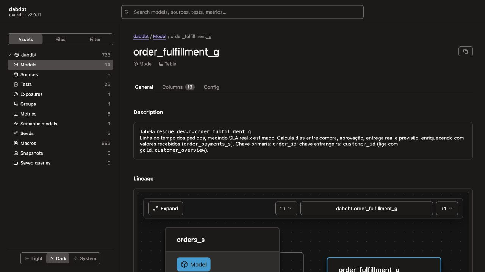

# Aula bônus — Migração na prática: do dbt Core 1.12 ao dbt OSS v2

**Duração:** 22 minutos. **Nível:** intermediário com SQL básico. **Trilha:** open source, opcional, após a temporada principal.

## Gancho

“O número de receita bateu no motor novo. Você liberaria a migração? No teste do Mac, o número bateu e duas versões com contrato falharam. Vamos descobrir por quê no laboratório de pedidos.”

## Objetivo e pré-requisitos

- Comparar duas versões na mesma amostra e aprender a interpretar a evidência de uma migração.
- Ter concluído o [checkpoint 01](../lab/dabdbt/checkpoints/README.md). Os [contratos do episódio 5](05-contratos-versoes.md) ajudam a entender o bloqueio.
- Usar Python 3.12 ou 3.13 e o ambiente da Aula 0. A primeira instalação e a resolução dos pacotes do dbt precisam de internet.
- Abrir a raiz do repositório. O [Codespaces](../docs/codespaces.md) é o ambiente recomendado. A trilha principal continua no Core 1.12.7.

## Roteiro falado

| Slide | Entrada | Tela ou ação |
|---|---|---|
| 01 | 00:00 | Capa e pergunta de abertura |
| 02 | 00:55 | Mesma receita, contrato com falha |
| 03 | 02:00 | Mapa da aula |
| 04 | 02:35 | O que aprendemos com a linha 1.12 |
| 05 | 04:00 | Core 1.12.7, dbt OSS v2 e distribuição completa |
| 06 | 05:25 | Arquitetura do teste lado a lado |
| 07 | 06:45 | Instalação e comando de comparação |
| 08 | 08:20 | Parse, seeds e primeira falha |
| 09 | 09:45 | Isolar `persist_docs` e preservar contratos |
| 10 | 11:15 | Ler a evidência no relatório e no log |
| 11 | 12:45 | SQL da receita entregue |
| 12 | 14:10 | Comparação dos 8 pedidos e três totais |
| 13 | 15:35 | Abra o dbt Docs v2 e localize a Gold |
| 14 | 17:05 | Ficha real e linhagem de modelos |
| 15 | 18:05 | Artefatos e testes antes de migrar |
| 16 | 20:05 | Radar, exercício final e fechamento |

### 01 · A pergunta que abre a aula

**Fala sugerida:** “Até aqui, construímos um pipeline que entrega dados para relatórios e agentes. Hoje vamos trocar o motor só em uma cópia e observar quais garantias continuam de pé. Imagine que a receita entregue dá o mesmo valor. Isso basta para liberar a migração?”

**O que destacar:** Mostre o título e diga que é a mesma amostra de pedidos da temporada.

**Transição:** “Vamos imaginar o impacto no consumidor do outro lado.”

### 02 · O número bateu

**Fala sugerida:** “Quem recebe a Gold depende de mais coisas além de um total. Um dashboard pode depender de um tipo de coluna. Um agente pode depender da definição de receita entregue. Vamos separar paridade do número, saúde do pipeline e continuidade do contrato.”

**O que destacar:** A receita entregue é um resultado. O contrato registra a interface prometida.

**Transição:** “Vamos usar as três verificações como mapa.”

### 03 · Roteiro da aula

**Fala sugerida:** “Primeiro entendemos por que a base do curso é o Core 1.12. Depois rodamos o mesmo projeto em dois motores. Comparamos os pedidos e abrimos o catálogo v2. No fim, você decide com evidências se liberaria a promoção.”

**O que destacar:** Mostre os quatro horários para facilitar a navegação no vídeo.

**Transição:** “Começamos com o que já funciona hoje.”

### 04 · Por que aprender a versão 1.12

**Fala sugerida:** “Uma equipe pode ter projetos e automações em uso na linha 1.x. Conhecer essa base ajuda a ler um projeto que você recebe, identificar quais garantias ele oferece e planejar a mudança. A linha 1.12 segue no calendário oficial de suporte, consultado na preparação da aula.”

**O que destacar:** Modelos, testes e contratos formam a referência para validar a troca.

**Transição:** “Agora vamos escolher a distribuição da segunda execução.”

### 05 · Qual v2 usamos

**Fala sugerida:** “Nesta demonstração, a primeira instalação é dbt Core 1.12.7. A segunda usa o pacote Python dbt-oss 2.0.11, a distribuição Apache 2.0 do dbt v2. A dbt Labs também oferece uma distribuição completa. A comparação oficial distingue as capacidades das duas, inclusive a compreensão de SQL para linhagem de coluna.”

**O que destacar:** A aula usa comandos e documentação do pacote OSS local com DuckDB.

**Transição:** “Mesmo chamando os executáveis de dbt, precisamos isolá-los.”

### 06 · Dois ambientes, uma amostra

**Fala sugerida:** “O comando gera duas cópias do projeto e bancos DuckDB novos. Ambas usam as mesmas seeds e a mesma regra de negócio. O binário v2 fica em outro ambiente para evitar que a instalação substitua o dbt das outras aulas.”

**O que destacar:** Cada lado tem seu perfil DuckDB, sua pasta de resultados e seu banco.

**Transição:** “Vamos executar na raiz com três comandos.”

### 07 · Comandos da prática

**Fala sugerida:** “Quem fez a Aula 0 pode começar pela instalação da aula bônus. O segundo comando do bônus faz a comparação. Aguarde ele terminar e confira a pasta criada. Uso o mesmo fluxo no terminal do Codespaces e dou tempo para o aluno localizar os arquivos.”

**O que destacar:** Mostre `setup` da aula bônus separado do `setup` da trilha. A instalação inicial e a resolução dos pacotes usam rede.

**Transição:** “Os primeiros logs contam uma história diferente do build.”

### 08 · Parse e seeds passaram

**Fala sugerida:** “O parse carrega a definição do projeto. Seed carrega os CSVs. A execução dos modelos é outra etapa. Na comparação no Mac, os dois primeiros passos do v2 passaram, mas a seleção da Gold com a configuração original encontrou um erro na Silver. Abra o seu relatório para ver o que ocorreu no seu ambiente.”

**O que destacar:** Abra os logs 04, 05 e 06. Leia o nome da etapa antes da mensagem.

**Transição:** “Vamos variar uma configuração e observar novamente.”

### 09 · Um ajuste controlado

**Fala sugerida:** “Na cópia do v2, desligamos persist_docs para separar a gravação de comentários físicos da criação das tabelas. O laboratório preserva as descrições YAML e as regras funcionais. No teste do Mac, a Gold de pedidos ficou disponível no outro banco novo e as duas versões de order_metrics com contrato ainda deram erro. Temos um problema reproduzível, e o log é a evidência.”

**O que destacar:** Use o antes e depois na cópia. Preserve constraints e contratos, inclusive no segundo build.

**Transição:** “Procure a falha e o nome do modelo no resultado.”

### 10 · Leia a falha pelo nome

**Fala sugerida:** “No resultado JSON da demonstração no Mac, modelos com erro lista as duas versões. No log 07 dessa execução, o DuckDB reporta que não pode preparar várias instruções de uma vez. A observação identifica onde investigar a combinação entre execução, materialização e adaptador. A mensagem sozinha não confirma a causa raiz.”

**O que destacar:** O cenário é específico das versões e do projeto testados. Guarde log e versão do motor ao reportar.

**Transição:** “Ainda podemos comparar o recorte Gold que foi construído.”

### 11 · SQL da receita entregue

**Fala sugerida:** “Repare que a Gold já consolidou pagamentos por pedido. Lemos uma linha por pedido; o filtro entregue entra no agregado e basta para medir a receita entregue neste recorte. A mesma consulta roda nos dois bancos. Ela continua copiável mesmo se você estiver lendo o PDF.”

**O que destacar:** Rode ou selecione a consulta `receita.sql`. Para a comparação no DuckDB, abra o arquivo de cada execução quando o build terminar.

**Transição:** “Agora vamos ver o número e conferir a granularidade.”

### 12 · Paridade de um recorte

**Fala sugerida:** “O script verifica igualdade linha a linha em cinco campos: ID, status, data do pedido, pagamento total e prazo. Os dois motores trazem oito pedidos, 740 de receita bruta e 630 de receita entregue. Na execução do Mac, o relatório de migração segue bloqueado pelo erro nos contratos. É assim que uma evidência positiva convive com um bloqueio de release.”

**O que destacar:** Mostre `recorte.linhas_iguais` e `resultado_migracao` juntos. Valores pertencem à amostra didática.

**Transição:** “O mesmo recorte já oferece um catálogo útil para investigação.”

### 13 · Explore o catálogo v2

**Fala sugerida:** “Abra o dbt Docs v2 do bônus. Clique em Assets → Models → order_fulfillment_g. Observe o que o catálogo mostra sobre o recurso e a linhagem de modelos. Use esse caminho para explicar de onde vem o pedido antes de olhar o SQL. Na edição OSS, mantemos a demonstração no nível de modelos.”

**O que destacar:** Terminal em execução e porta privada 8580 no Codespaces. Localmente, abra `http://localhost:8580`. Encerre com Ctrl+C.

**Transição:** “O catálogo é uma parte do material que você arquiva junto com os testes.”

### 14 · Leia a ficha do modelo

**Fala sugerida:** “Aqui está o catálogo v2 da execução. General mostra a descrição e a linhagem. Columns abre os campos. Leia o DAG no nível dos modelos: orders_s e order_payments_s alimentam a Gold. Para escrever SQL, confira o nome em Metadata → Relation, que aqui termina em g.order_fulfillment.”

**O que destacar:** A descrição herdada contém um nome do outro perfil. A relação do DuckDB aparece nos metadados da execução. A captura mostra o início da linhagem; use Expand na prática.

**Transição:** “Com a documentação e o resultado guardados, podemos decidir quais testes faltam.”

### 15 · A decisão de mudança

**Fala sugerida:** “No Core, usamos manifest.json e run_results.json. O v2 mantém JSON para compatibilidade e gera tabelas Parquet para consultar os metadados. Registre versão, resultados e paridade. Depois amplie para os produtos que os consumidores de fato usam: versões de modelo, testes, contratos, métricas, integrações e eventuais diferenças de performance. No laboratório, a trilha estável do Core é a referência para retomar a prática.”

**O que destacar:** Abra `resultado.json`, o resultado de build preservado em `07-v2-run-results.json` e o Parquet de modelos em `v2/target/info_schema/v1/dbt.models.parquet`. Restauração envolve código, dependências e dados no ambiente real.

**Transição:** “Vamos terminar com um exercício que dá material para uma próxima série.”

### 16 · Radar, exercício e CTA

**Fala sugerida:** “Escolha um produto Gold e escreva os critérios que permitiriam migrá-lo. Inclua um número, uma regra funcional, um contrato e um consumidor. Em uma próxima série dedicada ao v2, poderíamos testar compatibilidade de adaptadores, artifacts para CI e medir diferenças de execução com a mesma metodologia.”

**O que destacar:** Peça ao aluno que justifique a decisão com uma evidência do relatório e uma evidência do log.

**Transição:** “Deixe o seu critério de promoção nos comentários.”

## Checkpoint executável

Na raiz, com o terminal indicado na [Aula 0](../docs/aula-00.md):

```bash
python course.py setup
python course.py bonus-v2 setup
python course.py bonus-v2 compare
python course.py bonus-v2 docs
```

Use o primeiro comando somente se o laboratório principal ainda estiver pendente. No Windows, `py -3.12` é a alternativa se `python` estiver indisponível. Em macOS/Linux, use `python3.12` se necessário.

1. Leia `build/bonus-v2/resultado.json` e procure o identificador `execucao`. Cada comparação cria uma pasta nova em `build/bonus-v2/`.
2. Abra a pasta registrada. Compare `06-v2-original.log` e `07-v2-isolado.log`, e verifique `core/target/` e `v2/target/`. Os arquivos `06-v2-run-results.json` e `07-v2-run-results.json` preservam os resultados dos builds. A geração do catálogo exporta o índice já escrito pelo build. O primeiro build v2 usa o `persist_docs` original e seleciona apenas os testes cujas dependências estejam no recorte (`--indirect-selection cautious`). A segunda desativa os comentários físicos só para investigar a falha.
3. Em `core.duckdb` e `v2.duckdb`, consulte `g.order_fulfillment` com o [SQL da receita](../lab/bonus-v2/receita.sql). O [SQL de comparação](../lab/bonus-v2/comparacao.sql) lê o JSON usando a raiz do repositório como diretório de trabalho.
4. Com a documentação em execução, abra a porta privada **8580** na aba **Portas** do Codespaces ou `http://localhost:8580` em uma instalação local. Se a porta estiver ocupada, use `python course.py bonus-v2 docs --port 8581`.



*Ficha do modelo da Gold, gerada localmente pelo dbt OSS 2.0.11. Abra **Expand** para explorar o DAG.*

| Verificação | Resultado esperado na amostra |
|---|---|
| Core 1.12.7 | Build completo |
| dbt OSS 2.0.11, mantendo `persist_docs` | Parse e seeds concluídos; no teste do Mac, falha ao criar modelos Silver |
| dbt OSS 2.0.11, comentários físicos desativados na cópia | Gold de pedidos disponível; no teste do Mac, versões do modelo `order_metrics` com erro |
| Linhas comparadas | 8 equivalentes em cinco campos |
| Receita bruta / receita entregue | 740 / 630 em ambos |
| Decisão | Leia `resultado_migracao` e compare com os logs da sua execução |

O relatório usa `bloqueada` quando reproduz a falha de instruções múltiplas nos modelos com contrato. Se o build v2 terminar com sucesso, registra `build_aprovado_aguarda_paridade_completa`. O sucesso do build e a paridade da Gold são evidências para seguir a avaliação.

## Limitações, governança e FinOps

O recorte cobre o caminho da Gold de pedidos. Uma migração real inclui toda a suíte, consumidores, métricas e contratos. Nenhum ganho de performance foi medido. A validação compara o resultado de negócio antes de qualquer discussão de custo. O mesmo cuidado vale para agentes e dashboards: troque o motor preservando comportamento, documentação e interfaces de consumo.

## Radar

A temporada de um eventual curso dedicado ao v2 pode incluir avaliação por adaptador, diagnóstico de compatibilidade, artefatos e comparação de performance. Consulte a distinção oficial entre as distribuições e valide cada demonstração no pacote escolhido.

## CTA

Escreva seu critério de aprovação para uma Gold e aponte a evidência que falta para migrar. Use número, contrato e consumidor no mesmo raciocínio.

## Fontes

- [Guia oficial de migração para v2](https://docs.getdbt.com/docs/dbt-versions/dbt-upgrade/upgrading-to-v2?version=2)
- [Ciclo de suporte das versões](https://docs.getdbt.com/docs/dbt-versions)
- [Disponibilidade geral do v2](https://docs.getdbt.com/blog/dbt-v2-is-ga)
- [Comparação oficial entre dbt e dbt OSS](https://docs.getdbt.com/blog/comparing-dbt-and-dbt-oss)
- [Pacote dbt OSS 2.0.11 no PyPI](https://pypi.org/project/dbt-oss/2.0.11/)
- [Validação de contratos de modelos](https://docs.getdbt.com/docs/mesh/govern/model-contracts)
- [Documentação de persist_docs](https://docs.getdbt.com/reference/resource-configs/persist_docs)
- [Evidências do laboratório](../pesquisa/dossie-tendencias.md)

## Material complementar

| Título | Origem e tipo | Idioma | Como usar | Verificação |
|---|---|---|---|---|
| Guia de migração | dbt Labs, documentação | EN | Checar drivers, flags e mudanças antes de trocar o motor | 2026-11-24 |
| Comparação das distribuições | dbt Labs, artigo técnico | EN | Identificar recursos disponíveis no OSS e no binário completo | 2026-11-24 |
| Contratos e versões | Rescue Point, roteiro e checkpoint | PT-BR | Retomar o que cada versão promete ao consumidor | 2026-11-24 |
